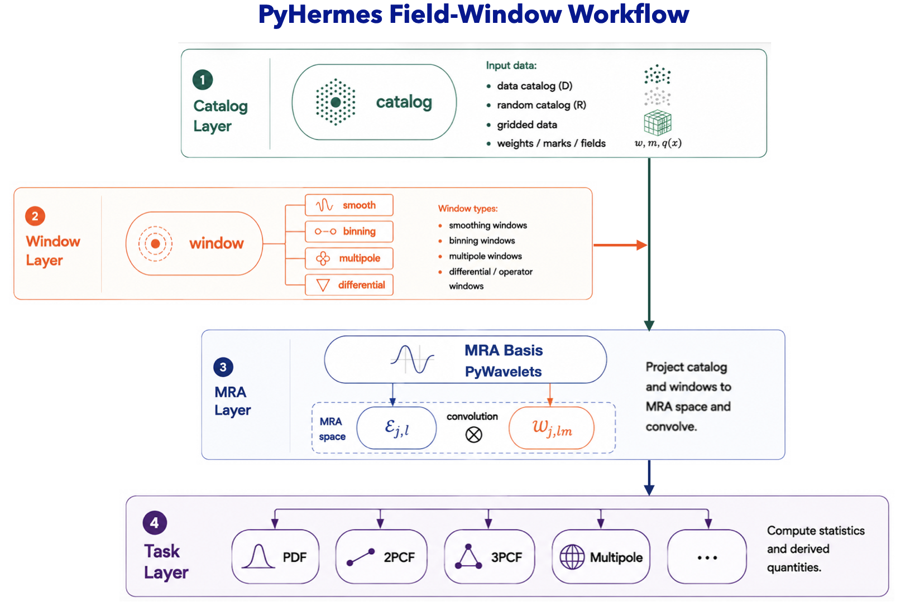

<p align="center">
  
</p>

# PyHermes

[](https://github.com/SYSUSPA-Projects/PyHermes/actions/workflows/ci.yml)
[](https://pyhermes.astroslacker.com)
[](https://pypi.org/project/pyhermes-cosmo/)
[](https://pypi.org/project/pyhermes-cosmo/)
[](LICENSE)

**PyHermes** is the high-performance Python implementation of **Hermes**
(HypER-speed MultirEsolution cosmic Statistics), an in situ framework that
turns particle catalogues into reusable multiresolution fields for cosmic
statistics and physical-field analysis.

A catalogue is projected once into a scaling-function-coefficient field
(`SFCField`). Smoothing, geometric binning, multipole decomposition,
differentiation, and inverse-Laplacian operations are then expressed through
`WindowFunc` objects. The same field can therefore feed Counting, isotropic
and anisotropic 2PCFs, standard and multipole 3PCFs, marked statistics, and
derived physical fields without returning to particle-level tuple counting
for every configuration.

- **Documentation:** [pyhermes.astroslacker.com](https://pyhermes.astroslacker.com)
- **Source:** [SYSUSPA-Projects/PyHermes](https://github.com/SYSUSPA-Projects/PyHermes)
- **Paper:** [arXiv:2607.23494](https://arxiv.org/abs/2607.23494)
- **Tutorials:** [`examples/notebooks/`](https://github.com/SYSUSPA-Projects/PyHermes/tree/main/examples/notebooks)
- **Runnable configurations:** [`examples/configs/`](https://github.com/SYSUSPA-Projects/PyHermes/tree/main/examples/configs) and
  [`examples/scripts/`](https://github.com/SYSUSPA-Projects/PyHermes/tree/main/examples/scripts)



## What It Covers

- catalogue-to-field projection with configurable compactly supported scaling
  functions and resolution `J`;
- built-in and user-defined smoothing, binning, multipole, and operator windows;
- one-point counting and field sampling;
- isotropic and anisotropic 2PCF measurements;
- Monte Carlo and spherical-harmonic 3PCF estimators;
- MPI/thread parallelism and CPU or CUDA contraction for 3PCF multipoles;
- weighted fields, velocity derivatives, Poisson potential, acceleration, and
  density-dependent marks.

### Optional spectral 2PCF computation

The updates in this section and the standard angular 3PCF section below are
available on source `main` and recorded under **Unreleased** in
[CHANGELOG.md](CHANGELOG.md). Install that checkout when following its
examples; a PyPI installation follows its published release. See the
[release and migration guide](docs/release_notes.rst) for compatibility.

The source tree includes an opt-in spectral path with automatic window
strategies. Add these settings to an existing `Corr_2PCF` task, keeping its
window definition, bin edges, and sampling:

```python
fast_options = dict(
    memory_strategy="speed",
    pair_reduction="spectral",
    reuse_input_fields=True,
    spectral_window="auto",
    spectral_fft="shared",
)
```

Parseval's identity evaluates the required field products directly in Fourier
space, avoiding inverse FFTs and full convolution-result arrays. Prepared inputs,
source spectra, and adjacent finite-shell boundaries are reused within one run.
`auto` groups exact radial frequency classes for `shell`, `gaussian_shell`,
`thick_shell`, and other built-in isotropic windows. For a grid-axis line of
sight, `ring`, `gaussian_ring`, `disk`, `cylshell`, and `cylinder` share a separable factor-table
backend; `cubic` reuses this backend through its three sinc factors. Tilted or unsupported windows retain the applicable generic path.
Every original alias scaling weight and folding multiplicity is retained;
there is no interpolation or change to the window definition.

The default remains the convolution path. Caches do not reuse production results
between runs; custom or unsupported windows retain their existing fallbacks.
See the [2PCF spectral guide](docs/get_start/corr_2pcf/optimization.rst) for
parameters, equations, memory limits, and total-time versus main-loop timing,
and the [controlled window-strategy report](docs/2pcf_window_strategies_results_20261017.md)
for numerical checks and workload-specific performance, including the
[matched 46×51 axial-window measurements](docs/2pcf_window_strategies_results_20261017.md#matched-axial-sampling-follow-up)
and amortized task time per sample.

### Direct field-pair evaluation

A real `SFCField` can prepare a reusable local pair for an existing list of
compatible `WindowFunc` objects:

```python
with delta.pair_with(delta, threads=8) as pair:
    xi = pair.evaluate(windows) / RR
```

`pair.evaluate(windows)` returns the coefficient-array pair mean in input order
and shares automatic window plans. Apply your estimator's normalization
explicitly; `RR = rho**2` is the uniform-reference case. For one window, use
`pair.evaluate([window])[0]`. Different real fields can be passed to
`first.pair_with(second)`. Complex-response windows retain the phase-preserving
convolution fallback. Keep inputs unchanged until the pair is closed; the
`with` block releases its retained powers. Distributed sampling and task-level
normalization remain available through `Corr_2PCF` and its existing options.

The direct-reconstruction section in the [2PCF tutorial](examples/notebooks/corr2pcf.ipynb)
explains the convolution and Parseval formulations and their task options.
See the [local pair evaluation guide](docs/get_start/corr_2pcf/optimization.rst#local-field-pair-evaluation)
for a complete example, normalization, lifetime and timing boundaries.

### Standard angular three-point statistics

`Corr_3PCF` prepares box-random contrast fields once per product and shares the
exact 2PCF backend for its lower-order pair series and `Q` postprocessing. This
adds no user setting and retains the sampled centres, rotations, seeds, weights,
interpolation and alias folding. Root-only pair planning uses local communication.
See the [angular 3PCF guide](docs/get_start/corr_3pcf/corr_3pcf.rst) and
[verified measurements](docs/3pcf_angular_optimization_results_20261017.md). The report separates local synthetic profiles from verified J8 catalogue DDD/Q timings on 128 CPU cores; the catalogue timings are not a controlled full-size baseline speedup.

### Three-point multipoles in 1.2

`Corr_3PCF_Multipole` offers two summation methods through the same task and
result interface:

| Calculation | `summation_method` | `summation_backend` |
| --- | --- | --- |
| Grid CPU | `gamma` | `cpu` |
| Grid CPU + GPU | `gamma` | `gpu` |
| Particle CPU (experimental) | `particle` | `cpu` |

Defaults remain `gamma` and `gpu`; explicitly select `cpu` without CUDA.
All paths construct harmonic arms using CPU FFTs. Particle summation reads
those arms at catalogue positions, requires retrievable particle data, and
supports an **unfiltered first vertex** only. Use `window2`/`window3` for
endpoint smoothing and omit `window`/`window1`. Particle and Gamma summation
have different finite-resolution discretizations.

Start with the CPU-only synthetic example, which needs no download:

```bash
python examples/scripts/demo_3pcf_particle.py --output-dir ./examples/output/particle_demo
```

For a saved field and its particle companion, use
[`param_3pcf_multipole_particle.yaml`](examples/configs/param_3pcf_multipole_particle.yaml)
with the normal multipole driver. The
[multipole guide](https://pyhermes.astroslacker.com/get_start/corr_3pcf_multipole/corr_3pcf_multipole.html)
explains serial/MPI execution, weights, windows, and saved results.

Version 1.2 fixes Gamma triple overlaps and reuses CPU workspaces and source
FFTs. **Recompute affected Gamma multipole measurements made with 1.1;
existing catalogue projections can be reused.** Source FFT reuse trades
memory for computation; speedups depend on workload and CPU placement.
See [CHANGELOG.md](CHANGELOG.md) for the correction and migration notes.
The [verified example refresh](docs/examples_refresh_results_20261017.md)
records the new 2PCF and corrected CPU multipole outputs, observed timings,
input provenance and executed notebook plots. Historical results are retained.

## Installation

For a published release, install PyHermes from PyPI:

```bash
python -m pip install pyhermes-cosmo
```

This installs PyHermes and its regular Python dependencies automatically. MPI
and CUDA are optional, so neither is required for the default installation.

To use the current repository examples and Unreleased optimizations, install
the same checkout from its repository root before entering `examples/`:

```bash
python -m pip install -e ".[plot]"
```

Keep the code and example configurations on the same commit. See the
[installation guide](docs/install.rst) for development, MPI and CUDA setup.

The Python import name remains unchanged:

```python
import pyhermes
```

For a ready-to-use MPICH environment on Linux or macOS:

```bash
conda create -n pyhermes -c conda-forge python=3.12 mpi4py mpich pip
conda activate pyhermes
python -m pip install pyhermes-cosmo
mpiexec -n 2 python -c "from mpi4py import MPI; print(MPI.COMM_WORLD.rank)"
```

Here conda provides a mutually compatible MPI runtime and Python binding, while
pip installs PyHermes and the remaining Python dependencies. PyHermes does not
yet require a separate conda package for this workflow.

Without `mpi4py`, PyHermes automatically uses its single-process MPI fallback.
Users of an existing cluster MPI should follow the
[installation guide](https://pyhermes.astroslacker.com/install.html) for
the matching `mpi4py` and GPU setup.

## Smallest Workflow

The tracked Quick Start configurations use paths relative to `examples/`:

```bash
cd examples
python scripts/run_sfc_projection.py configs/param_sfc_projection.yaml
python scripts/run_2pcf.py configs/param_2pcf.yaml
```

The first command downloads and caches the original single-file Quijote
`group_tab` catalogue from the URL in the YAML, verifies its SHA256 digest,
and writes the base `SFCField`. The second command consumes that exact field
and writes an isotropic `Corr2PCFData` result. The matching
`quick_start.ipynb` executes the same configs and plotting code rather than
maintaining a parallel example.

The dedicated `particle_io.ipynb` reuses that catalogue and shows how the
native FoF reader, an NPZ conversion, and a raw BIN layout all feed the same
projection API. The converted NPZ and BIN files are local teaching products,
not additional public downloads.
`sfc_projection.ipynb` then builds the J=9, weighted, redshift-space, and
explicit sampled-random fields used by later examples;
`scripts/prepare_sfc_fields.py` provides the equivalent non-interactive batch
entry point. The optional dark-matter snapshot builder accepts the local
Gadget HDF5 snapshot prefix explicitly; no cluster-specific path is embedded
in the code:

```bash
python scripts/build_quijote_dm_sfc_field.py /path/to/snapdir_004/snap_004
```

```python
from pyhermes.base.sfc_projection import SFCProjection
from pyhermes.io import WindowFunc
from pyhermes.param.parambase import read_param

params = read_param("./configs/param_sfc_projection.yaml")
field = SFCProjection(params).run()

gaussian = WindowFunc(
    {"type": "gaussian", "len_args": {"R": 10.0}},
    field.sfc_info,
    threads=8,
)
smoothed_field = field @ gaussian
```

This is the core language of PyHermes: **field @ window**. Statistical tasks
build the required window families and normalizations around the same objects.

## Start With The Notebooks

The recommended route through
[`examples/notebooks/`](https://github.com/SYSUSPA-Projects/PyHermes/tree/main/examples/notebooks)
is:

1. [`quick_start.ipynb`](https://github.com/SYSUSPA-Projects/PyHermes/blob/main/examples/notebooks/quick_start.ipynb)
2. [`particle_io.ipynb`](https://github.com/SYSUSPA-Projects/PyHermes/blob/main/examples/notebooks/particle_io.ipynb)
3. [`sfc_projection.ipynb`](https://github.com/SYSUSPA-Projects/PyHermes/blob/main/examples/notebooks/sfc_projection.ipynb)
4. [`window.ipynb`](https://github.com/SYSUSPA-Projects/PyHermes/blob/main/examples/notebooks/window.ipynb)
5. [`physical_fields.ipynb`](https://github.com/SYSUSPA-Projects/PyHermes/blob/main/examples/notebooks/physical_fields.ipynb)
6. [`counting.ipynb`](https://github.com/SYSUSPA-Projects/PyHermes/blob/main/examples/notebooks/counting.ipynb)
7. [`corr2pcf.ipynb`](https://github.com/SYSUSPA-Projects/PyHermes/blob/main/examples/notebooks/corr2pcf.ipynb)
8. [`corr3pcf.ipynb`](https://github.com/SYSUSPA-Projects/PyHermes/blob/main/examples/notebooks/corr3pcf.ipynb)

The first four notebooks establish the common catalogue-to-field-to-window
workflow. Continue with physical fields, one-point Counting, or the
2PCF-to-3PCF statistics path according to the calculation you need.

Generated catalogues and estimator products are intentionally not committed.
The notebooks state which lightweight cells run locally and which script/YAML
pairs are intended for a workstation or cluster.

## Documentation

The full guide at [pyhermes.astroslacker.com](https://pyhermes.astroslacker.com)
follows the terminology and estimator definitions of the Hermes paper. It
covers the mathematical construction, current APIs, window catalogue,
parameter mappings, numerical validation, and performance interpretation.

To build the documentation locally:

```bash
python -m pip install ".[docs]"
sphinx-build -W -b html docs docs/_build/html
```

## Citing PyHermes

If PyHermes contributes to your work, please cite the software version and the
four papers that describe its scientific foundation and implementation:

1. **Hermes/PyHermes:** [Long-long Feng, Tengpeng Xu, Tian-Cheng Luan et al.
   (2026), *Hermes - Towards an Optimal High-Performance Algorithm for Cosmic
   Statistics of Large Data Sets*, arXiv:2607.23494
   [astro-ph.CO]](https://arxiv.org/abs/2607.23494).
2. **MRACS foundation:** [Feng (2007), *The Beylkin-Cramer Summation Rule and a
   New Fast Algorithm of Cosmic Statistics for Large Data
   Sets*](https://doi.org/10.1086/511024).
3. **In-situ correlation functions:** [Yue et al. (2024), *Pair counting
   without binning -- a new approach to correlation functions in clustering
   statistics*](https://doi.org/10.1093/mnras/stae2513).
4. **Isotropic 3PCF multipoles:** [Ju et al. (2026), *An optimal in situ
   multipole algorithm for the isotropic three-point correlation
   function*](https://doi.org/10.1093/mnras/staf2275).

Machine-readable metadata is provided in
[`CITATION.cff`](https://github.com/SYSUSPA-Projects/PyHermes/blob/main/CITATION.cff);
complete BibTeX entries are available in the
[citation guide](https://pyhermes.astroslacker.com/citing.html).
