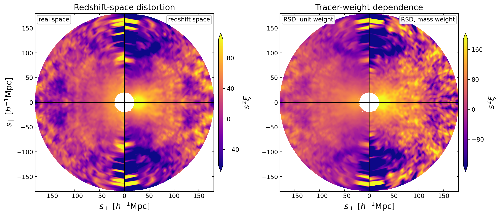
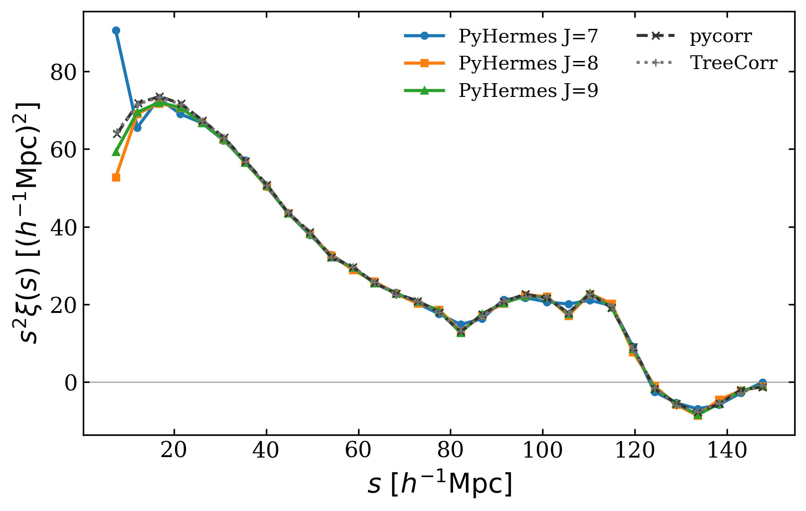
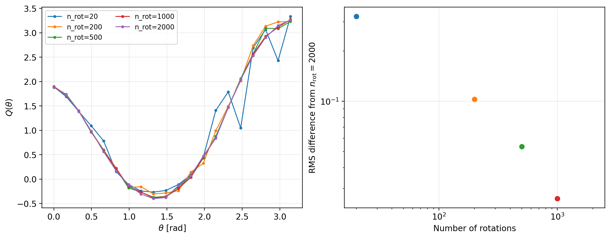
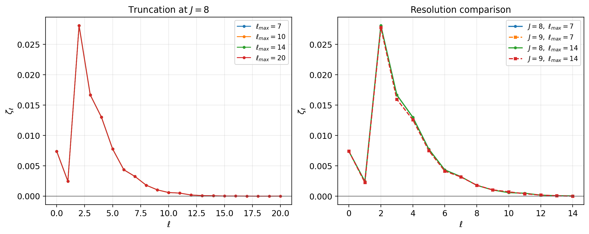
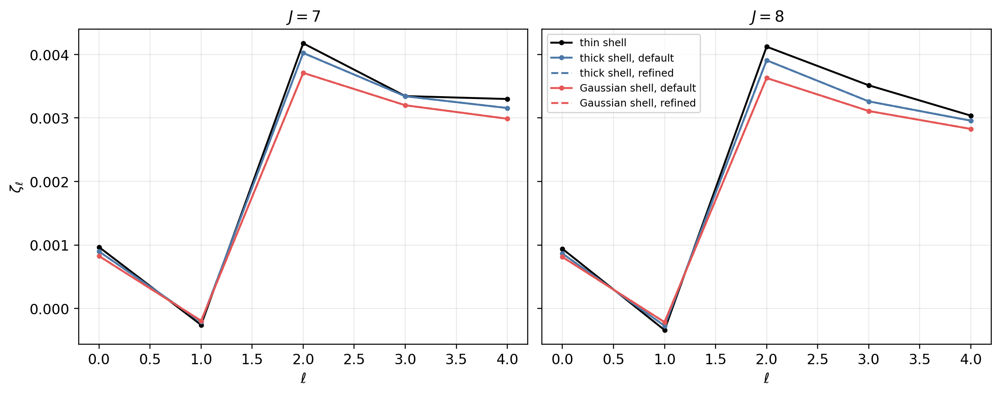
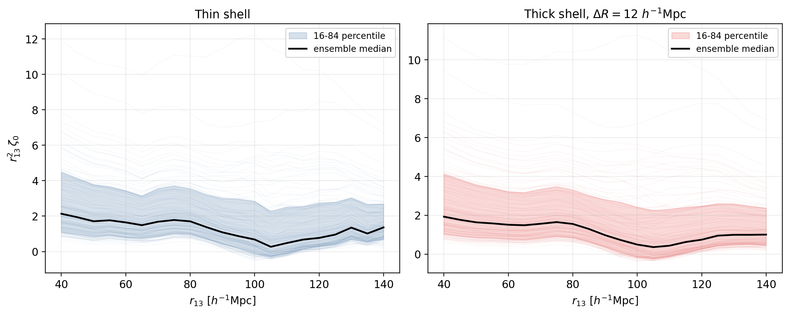
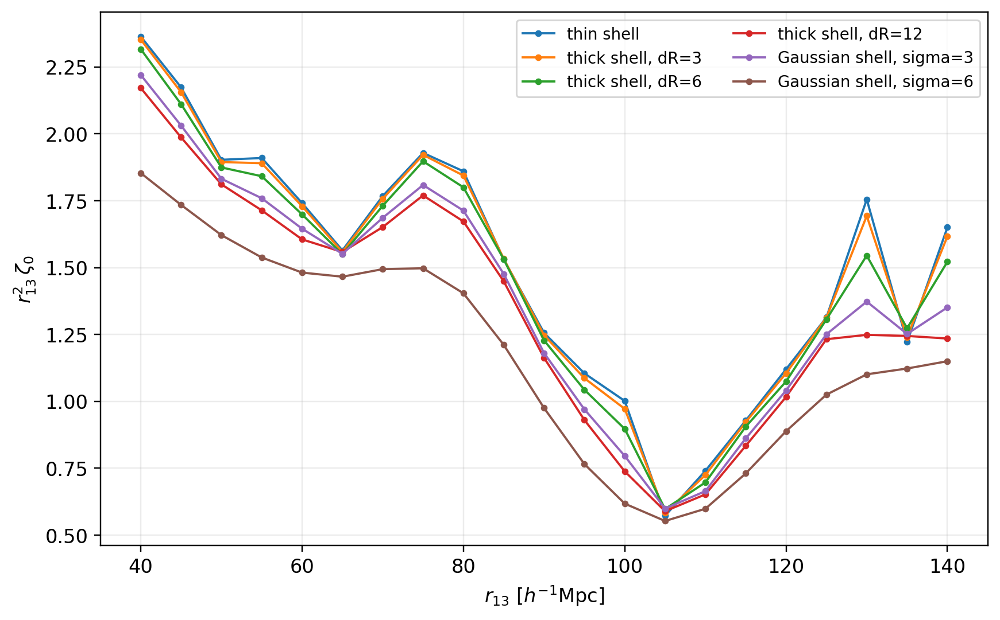
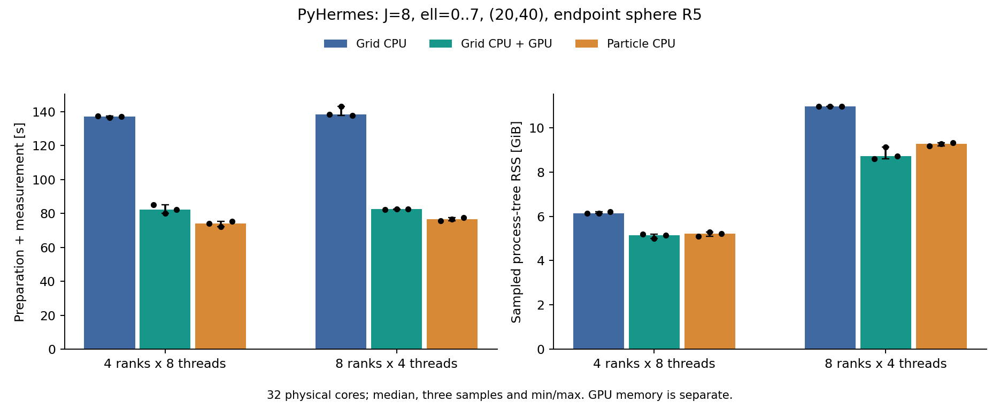

Validation and Performance
==========================

This page separates two questions that are easy to mix together:

* **Validation:** does a field--window estimator recover the expected statistic,
  and does it converge when the numerical controls are tightened?
* **Performance:** once the estimator is fixed, which part of the workflow sets
  the runtime and memory footprint?

The current three-point multipole performance section uses corrected
three-repeat measurements bundled as numeric JSON. The two-point and
direct-angular reference sections retain their earlier measurements. Older
unrecomputed multipole and Kun figures below are explicitly historical.

Reference Data
--------------

Unless stated otherwise, the validation examples use the Quijote
fiducial-cosmology halo catalogue from realisation 8000, snapshot 004
(``z = 0``):

* 406,728 FoF haloes in a periodic cube of side
  ``1000 h^-1 Mpc``;
* the ``db2`` scaling-function basis;
* ``J = 8`` for the main tests, with selected ``J = 9`` comparisons;
* the plane-parallel approximation for redshift-space measurements.

These are controlled algorithm tests, not a complete survey-analysis recipe.
Survey masks and spatially varying selection functions require an explicit
random catalogue or random ``SFCField``.

Numerical Validation
--------------------

Anisotropic 2PCF
~~~~~~~~~~~~~~~~

The same ``Corr2PCF`` task can measure real- and redshift-space fields by
changing the input ``SFCField`` while keeping the binning-window family fixed.
The plot below maps :math:`s^2\xi(s,\mu)` to the
:math:`(s_\perp,s_\parallel)` plane.  Joining two measurements at
:math:`s_\perp=0` makes the line-of-sight response immediately visible and
also provides a compact check of tracer weighting.

   Current grouped-test outputs.  Left: real space and unit-weight redshift
   space.  Right: unit- and mass-weighted redshift space.  The two halves of
   each circle share a colour normalization, while the two panels have
   separate colour bars because mass weighting has a larger dynamic range.
   The white centre excludes :math:`s<20\,h^{-1}{\rm Mpc}`.

For an independent estimator-level check, the paper compares the isotropic
Hermes result with direct periodic pair counting.  Agreement improves with
increasing ``J`` and is best interpreted only above the effective resolution
scale of the reconstructed field.

Standard 3PCF
~~~~~~~~~~~~~

The conventional ``Corr3PCF`` task estimates translational and rotational
averages by Monte Carlo sampling.  Convergence must therefore be checked in
``n_rot`` rather than inferred from one visually smooth curve.  In the current
test, the low-rotation result fluctuates visibly while the curves and their RMS
difference settle rapidly as ``n_rot`` increases.

   Left: :math:`Q(\theta)` for several rotation counts.  Right: RMS difference
   from the ``n_rot = 2000`` result.

3PCF Multipoles
~~~~~~~~~~~~~~~

.. warning::

   The next two convergence plots predate the 1.2 Gamma correction and are
   retained as historical analysis examples, not validation of 1.2. Corrected
   paper consistency and smoothing figures are in the multipole task guide.

Multipole measurements have two separate convergence controls.  ``lmax``
truncates the angular expansion, while ``J`` controls the MRA field resolution.
The left panel below verifies that increasing ``lmax`` appends higher orders
without changing the already computed low-order multipoles.  The right panel
compares those common modes between ``J = 8`` and ``J = 9``.

For non-shell radial profiles, PyHermes tabulates the required radial transform.
The default and refined tables should agree before a profile is used for
production measurements.  The following check covers the thin-shell analytic
path and the numerical thick- and Gaussian-shell paths.

An Ensemble-Level Check
~~~~~~~~~~~~~~~~~~~~~~~

.. warning::

   These historical Kun figures predate the Gamma correction. Recompute
   affected multipoles before interpreting amplitudes; they are not current
   validation. The documentation does not distribute collaborator catalogues
   or their new production labels.

The Kun scan provides a larger application test: ``r12 = 20 h^-1 Mpc`` is held
fixed while ``r13`` varies.  The 129 mocks used here span different cosmological
parameters.  Their spread is therefore **not** a covariance estimate for one
cosmology; it is shown to inspect the stability of the full projection and
monopole pipeline over a deliberately broad simulation ensemble.

The binning profile is part of the observable, not merely a plotting choice.
For one mock, widening a finite shell or increasing the Gaussian-shell width
averages a broader neighbourhood of triangle configurations:

   One input field and one radial scan measured with six binning profiles. The
   smooth variation between profiles is the expected finite-bin response.

Performance Model
-----------------

The catalogue is projected once onto
:math:`N_{\mathrm{MRA}}=2^{3J}` coefficients.  Gamma measurements operate on fields and windows, so their leading cost
depends on resolution and window evaluations. Particle summation additionally
scales with the number of centre particles and the readout stencil size.

For ``N_w`` window applications on a matching FFT grid,

.. math::

   T_{\mathrm{conv}}
   = \mathcal{O}\!\left(N_w N_{\mathrm{MRA}}
     \log N_{\mathrm{MRA}}\right).

The task-specific multiplicities are:

* ``Corr2PCF``: ``N_s * N_mu`` or ``N_rp * N_pi`` sampled binning windows;
* ``Corr3PCF``: translation samples times random rotations;
* ``Corr3PCFMultipole``:
  :math:`N_m=(\ell_{\max}+1)(\ell_{\max}+2)/2` explicitly evaluated
  non-negative-:math:`m` fields.

Increasing ``J`` by one multiplies the number of three-dimensional field
coefficients by eight.  Since some work buffers are rank-local, a high-``J``
job often benefits from fewer MPI ranks and more threads per rank.

Current Grouped Benchmark
-------------------------

The representative end-to-end jobs below use the same Quijote field and
geometric setup as the validation examples.  ``Average time`` is normalized by
the natural sampling unit of each estimator: one :math:`(s,\mu)` binning window
for the 2PCF and one centre--rotation--angle combination for the standard 3PCF.
Memory is the Slurm batch-step ``MaxRSS`` and therefore excludes GPU device
memory.

.. list-table:: Representative 2PCF and standard-3PCF jobs
   :header-rows: 1
   :widths: 13 33 6 10 12 15 11

   * - Product
     - Representative setup
     - ``J``
     - Parallel
     - Task total
     - Average time
     - MaxRSS
   * - :math:`DD(s,\mu)`
     - Ring binning windows, ``46 x 51`` samples
     - 8
     - ``8 x 8``
     - 119.7 s
     - 51.0 ms/sample
     - 8.7 GiB
   * - :math:`DDD(\theta;r_{12},r_{13})`
     - Particle centres, ``Ncen=406728``, ``n_rot=1000``, ``n_theta=20``
     - 8
     - ``16 x 8``
     - 84.0 s
     - 10.3 ns/comb.
     - 11.3 GiB
   * - :math:`DDD(\theta;r_{12},r_{13})`
     - Box-random centres, ``Ncen=8e6``, ``n_rot=200``, ``n_theta=20``
     - 8
     - ``16 x 8``
     - 280.6 s
     - 8.77 ns/comb.
     - 21.2 GiB

The CPU measurements used two AMD EPYC 9754 processors (256 physical cores in
total).  GPU measurements used one NVIDIA GeForce RTX 4090 with CUDA 12.4.
``ranks x threads`` below describes the CPU layout; GPU jobs use the same
CPU-side convolution layout and an ``(8, 8, 8)`` CUDA block for the final
contraction.

Corrected multipole measurements (1.2)
--------------------------------------

These archived measurements use J=8, lmax=7, thin shells at (20,40),
endpoint sphere R5, and an unfiltered first vertex. Each method/layout has
three samples; no slow sample is removed. Values below are medians with
minimum/maximum ranges. Kernel-level speedups are not substituted for total
wall time.

.. list-table:: PyHermes on 32 physical CPU cores
   :header-rows: 1

   * - Layout
     - Method
     - Total [s] (min--max)
     - Host RSS [GiB] (min--max)
   * - ``4x8``
     - grid CPU
     - 137.151 (136.273--137.222)
     - 6.144 (6.126--6.199)
   * - ``4x8``
     - grid CPU + GPU
     - 82.204 (80.089--85.062)
     - 5.143 (4.990--5.182)
   * - ``4x8``
     - particle CPU
     - 73.955 (72.053--75.441)
     - 5.226 (5.104--5.283)
   * - ``8x4``
     - grid CPU
     - 138.250 (137.756--143.143)
     - 10.955 (10.949--10.964)
   * - ``8x4``
     - grid CPU + GPU
     - 82.438 (82.243--82.524)
     - 8.708 (8.597--9.122)
   * - ``8x4``
     - particle CPU
     - 76.719 (75.787--77.550)
     - 9.262 (9.167--9.317)

   Bars: median; black dots: all three runs; whiskers: min/max.
   The two layouts each use 32 physical cores. Host memory excludes GPU memory.

Total time is the sum of fresh preparation and measurement process wall times,
including initialization and output, and excludes queue time. Host RSS is a
0.5-second sampled process-tree sum; shared pages may be counted more than
once. It is not the Slurm MaxRSS used for the older 2PCF/direct-3PCF table.
GPU device samples reach 4.00--4.25 GiB and are reported separately.

One RTX4090 is an additional resource. Some CPU methods ran within batches
that retained a GPU allocation. Layouts and repeats received different CPU
IDs, NUMA ratios, and run times; differences cannot all be attributed to the
rank/thread split. Convolved-field caching was disabled; Numba disk compilation
could be reused, and OS caches were not cleared. GPU initialization and
compilation are included. These are hardware-specific observations, not a
global optimum or an equal-cost/equal-accuracy comparison.

CPU and GPU Gamma results pass allclose at rtol=1e-8, atol=1e-11. Independent
periodized-basis integrals test the corrected overlap separately. Particle
summation is a different finite-J discretization, so its coefficient agreement
is not an absolute-accuracy measure.

All 18 numeric samples and result/source hashes are available in
:download:`the archived benchmark JSON <_static/results/threepcf_v1_2_benchmark.json>`.
Replot it without scientific measurements using
``python examples/scripts/plot_3pcf_benchmark.py --data PATH_TO_JSON --output figure.png``.

Reproducing the Checks
----------------------

Run the public CPU-only synthetic particle example to exercise projection,
particle companions, the task interface, and saved output. The test suite adds
independent Gamma/particle integrals and source-FFT reuse checks; the MPI CI
worker compares serial, pair MPI, and sample MPI on a small synthetic field.
CUDA checks require a real device or an explicitly labelled simulator.

The benchmark JSON above is sufficient to replot the published timing/RSS
figure without access to a private filesystem. Full raw production logs and
large catalogue fields remain local. Do not sum overlapping profile phases
or infer absolute accuracy from backend agreement.
