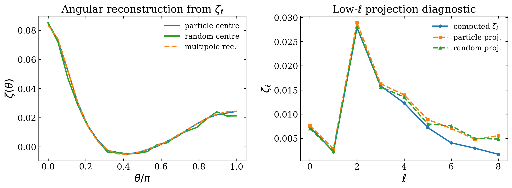

Standard 3PCF
=============

``Corr_3PCF`` measures the angular three-point correlation function for a
triangle with fixed sides :math:`r_{12}` and :math:`r_{13}`. It evaluates the
two displaced vertices as window-filtered fields, samples their product around a
set of primary vertices, and averages over random rotations. This is the
direct-angular counterpart of the harmonic estimator described in
:doc:`../corr_3pcf_multipole/corr_3pcf_multipole`.

The :doc:`complete 3PCF notebook </notebooks/corr3pcf>` compares the two
standard-3PCF centre strategies and shows how the saved count-level products
assemble into :math:`\zeta` and the reduced statistic :math:`Q`. Its later
sections introduce the multipole estimator.

Triangle convention
-------------------

The primary vertex is labelled 1. The two fixed sides are
:math:`r_{12}=|\mathbf{x}_2-\mathbf{x}_1|` and
:math:`r_{13}=|\mathbf{x}_3-\mathbf{x}_1|`; the angular coordinate is either
:math:`\theta` or :math:`\mu=\cos\theta`. The third side follows from

.. math::

   r_{23}^2=r_{12}^2+r_{13}^2-2r_{12}r_{13}\mu.

For every angular sample, PyHermes rotates this triangle ``n_rot`` times. The
rotation average is Monte Carlo: increasing ``n_rot`` reduces orientation
noise but increases runtime approximately linearly.

A minimal run
-------------

The example configuration below uses halo positions as primary vertices and
applies a :math:`5\,h^{-1}\mathrm{Mpc}` spherical window to the displaced
vertices:

.. code-block:: yaml

   Corr_3PCF:
      sfc_field: "./output/quijote8000_snap004_sfc.pkl"
      random: "uniform"
      window:
         type: "sphere"
         len_args:
            R: 5.0
      r12: 20.0
      r13: 40.0
      angle_param: "theta"
      theta:
         n_theta: 20
      n_rot: 20
      center: "particle"
      products: ["ddd", "Q"]
      base_seed: 42
      threads: 2
      fout_path: "./output/quijote8000_snap004_3pcf_pcenter_nrot20.pkl"

Run the tracked example from ``examples/``:

.. code-block:: bash

   python scripts/run_3pcf.py configs/param_3pcf_pcenter_nrot20.yaml

or construct the task directly:

.. code-block:: python

   from pyhermes.param.parambase import read_param
   from pyhermes.theory import Corr_3PCF

   params = read_param(config_path="./configs/param_3pcf_pcenter_nrot20.yaml")
   result = Corr_3PCF(params).run()

Choosing primary vertices
-------------------------

``center: particle``
   The first vertex is sampled at catalogue positions. This is efficient for
   sparse tracer catalogues and gives a dual-window estimator: ``window2`` and
   ``window3`` act on the two displaced vertices, while ``window1`` has no effect
   on the naked particle centre. The input ``SFCField`` must retain companion
   particle data, or ``particle_pos1`` and ``particle_weight1`` must be passed
   together.

``center: box_random``
   ``n_box_centers`` positions are drawn uniformly in the periodic box. All
   three vertices are evaluated as fields, so ``window1``, ``window2``, and
   ``window3`` can all be active. This mode is useful for dense particle
   samples or whenever the primary field itself must be filtered.

The shared ``window`` is copied to every vertex that does not define an explicit
``window1``, ``window2``, or ``window3``. In particle-centre mode this still
does not filter the first vertex. Use explicit vertex windows when that distinction
should be visible in the configuration.

For box-random centres, change only the centre section:

.. code-block:: yaml

   center: "box_random"
   n_box_centers: 1000000
   window2:
      type: "sphere"
      len_args: {R: 5.0}
   window3:
      type: "sphere"
      len_args: {R: 5.0}

Data, randoms, and products
---------------------------

``sfc_field`` supplies a shared data field; ``sfc_field1`` through
``sfc_field3`` override individual vertices. The random inputs follow the same
pattern. ``random: uniform`` uses the analytic constant-density shortcut,
whereas a path or ``SFCField`` represents an explicit random catalogue.

Requesting a final statistic automatically expands its dependencies:

.. list-table:: Main standard-3PCF products
   :header-rows: 1
   :widths: 20 80

   * - Product
     - Meaning
   * - ``ddd``, ``rrr``
     - Raw data and random triplet products.
   * - ``delta_ddd``
     - Connected data-minus-random triplet combination.
   * - ``xi12``, ``xi13``, ``xi23``
     - Two-point terms on the three triangle sides.
   * - ``zeta``
     - Connected three-point correlation function.
   * - ``zeta_H``
     - Hierarchical denominator
       :math:`\xi_{12}\xi_{13}+\xi_{12}\xi_{23}+\xi_{13}\xi_{23}`.
   * - ``Q``
     - Reduced 3PCF, :math:`Q=\zeta/\zeta_H`.

The particle-centre mode additionally exposes ``d_delta_dd`` and
``r_delta_dd``, the two centre-weighted contributions used to form
``delta_ddd``. Product availability is validated against the selected centre
mode; unsupported combinations fail early rather than silently changing the
estimator.

Angle sampling
--------------

Set ``angle_param`` to ``theta`` or ``mu`` and configure the matching section:

.. code-block:: yaml

   angle_param: "mu"
   mu:
      mu_min: -1.0
      mu_max: 1.0
      n_mu: 20

Explicit one-dimensional arrays are also accepted from Python. The output
stores both ``theta`` and ``mu`` together with ``r23``, so downstream plotting
does not need to reconstruct the triangle geometry.

Reading a result
----------------

.. code-block:: python

   from pyhermes.io import Corr3PCFData

   data = Corr3PCFData(
       data_path="./output/quijote8000_snap004_3pcf_pcenter_nrot20.pkl"
   )
   theta, Q = data.theta, data.Q

The arrays requested through ``products`` are available as attributes such as
``data.ddd``, ``data.zeta``, and ``data.Q``. Configuration and field metadata
are retained in ``data.corr3pcf_info`` and ``data.sfc_info1`` through
``data.sfc_info3``.

Runtime reuse and pair postprocessing
-------------------------------------

The angular estimator prepares the three box-random contrast fields once per
``delta_ddd`` product and MPI rank, rather than allocating them again at every
angle. The cache lasts only for that product and is released on completion or
failure. Particle-centre products retain their existing two-arm contrast reuse.

The lower-order pair terms used by ``xi12``, ``xi13``, ``xi23`` and ``Q`` reuse
the exact local 2PCF backend. Each pair series shares its input FFTs and powers
across radii; compatible windows use the existing exact radial or factor plans.
Unsupported windows retain convolution and release temporary full kernels after
each radius. Pair postprocessing runs on rank zero,
so planning uses only ``COMM_SELF`` and never constructs a collective 2PCF task
inside that root-only stage. FFT/power buffers are released after each series.

There is no new user option. Centre positions, per-rank seeds, rotation counts,
weights, interpolation stencils and alias-specific scaling/folding terms are
unchanged. Baseline-versus-candidate checks must use the same MPI rank count:
box-random centres use rank-specific seeds, so changing the rank count can change
the finite Monte Carlo sample independently of these implementation changes.

The benefit depends on workload. ``Q`` includes lower-order pair postprocessing;
a triplet-only task does not. Long Monte Carlo loops may dominate total time even
when pair postprocessing becomes much faster. See the
:download:`experimental measurements and validation
</3pcf_angular_optimization_results_20261017.md>` for the timing boundaries and
local-profile limitations.

Local synthetic measurements use one process and two threads, take the minimum
of three fresh-process measurements per arm, and exclude imports/small-grid
warmup. The first two rows use J=7, 512 centres and 4 rotations; the last uses
J=5, 8192 centres and 32 rotations. Every row has 20 angles. Totals include
in-memory preparation, sampled triplets and pair postprocessing; they contain no
projection or file IO and are not server/catalogue performance measurements.

.. csv-table:: Local angular 3PCF prototype timings
   :file: ../../_static/results/angular_3pcf_optimization_20261017.csv
   :header-rows: 1
   :widths: 46 20 20 14

The MC-dominated row has only about a 5 percent lower minimum total. Large gains
in the light-MC rows should not be extrapolated to production sampling. All
samples, phase timings, counters and source commits are available as
:download:`numeric JSON </_static/results/angular_3pcf_optimization_20261017.json>`.

Catalogue CPU measurements
--------------------------

A separate J=8 catalogue measurement uses 128 physical CPU cores (16 MPI ranks
with 8 threads each), 20 theta samples, r12=20/r13=40 Mpc/h and sphere-R5
smoothing at the two endpoints only. Particle centres use 406728 haloes and
1000 rotations; box-random centres use 8000000 positions and 200 rotations.
Time columns take the minimum of three fresh processes. Task total starts at
reading a preprojected field and excludes projection, import/warmup and output
IO. Main loop excludes initial preparation and lower-order pair postprocessing.

.. csv-table:: J8 angular catalogue candidate measurements
   :file: ../../_static/results/angular_3pcf_catalogue_20261017.csv
   :header-rows: 1
   :widths: 27 15 15 15 14 14

Memory is Slurm batch-step MaxRSS for one centre/product element, including its
gates and three repetitions. Q uses connected triplets and pair postprocessing;
its main loop is not raw DDD. The unchanged Monte Carlo loop dominates these
workloads; Q pair postprocessing takes about 1.8 seconds. Different historical
nodes/runtime policies and incomplete historical timing provenance prevent an
algorithm-only speedup claim. See the
:download:`catalogue repetitions and provenance
</_static/results/angular_3pcf_catalogue_20261017.json>` and experimental report
for ranges, the pure-DDD/Q distinction and historical Table3 timing boundaries.

Connection to multipoles
------------------------

   Direct angular estimates and the 3PCF multipole representation describe the
   same rotationally averaged signal. Residual differences arise from finite
   angular sampling, random rotations, centre sampling, and multipole
   truncation. These are the corrected Gamma multipoles; the two centre
   labels describe direct-angular Monte Carlo estimates, not the new particle
   multipole method. The right panel retains the original 20-angle trapezoid
   projection, whose high-order quadrature bias is a diagnostic limitation,
   not an independent absolute-accuracy estimate.

Use this task when the angular curve itself is the desired product. Use
``Corr_3PCF_Multipole`` when many angular configurations, high angular order,
or radial-window scans are more naturally represented through
:math:`\zeta_\ell`.
